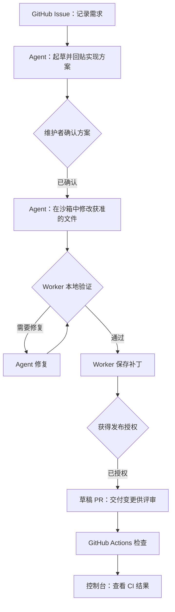
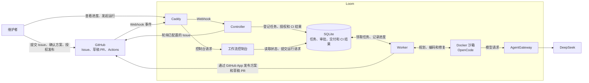

# Loom

Loom 是一套 **Agent 驱动的研发流程**，旨在改造从需求到交付的日常研发协作。它将 GitHub Issue、实现方案、代码变更和验证结果串成一条可追踪的流程，让 Agent 持续推进规划、编码与修复，让维护者在方案确认、发布授权和代码评审时做决定。

## 研发流程

- **需求和决策在 GitHub 留痕。** 实现方案回贴到原 Issue，由维护者回复 `/loom approve <方案编号>` 确认。草稿 PR 需要单独获得发布授权。
- **沙箱执行，验证后交付。** Agent 只在预先获准的文件范围内修改代码。Worker 运行本地检查，验证通过后保存补丁。
- **进度和结果可追踪。** 控制台汇总任务阶段、草稿 PR 和对应提交的 CI 结果，也可发起运行请求。

## 系统架构

Controller 接收签名 Webhook，并轮询已配置的 GitHub Issue。Worker 通过 SQLite 领取任务、记录阶段，并将 OpenCode 的模型请求交由 AgentGateway 转发给 DeepSeek。方案评论与草稿 PR 通过 GitHub App 发布。

## 部署

生产部署由 GitHub Actions 在变更合并到 `main` 后触发。首次配置见[部署流水线说明](deploy/README.md)。
