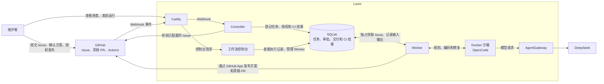
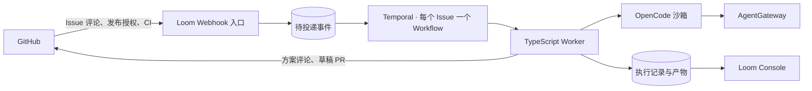

# Loom

Loom 是一套 **Agent 驱动的研发流程**，旨在改造从需求到交付的日常研发协作。它将 GitHub Issue、实现方案、代码变更和验证结果串成一条可追踪的流程，让 Agent 持续推进规划、编码与修复，让维护者在方案确认、发布授权和代码评审时做决定。

## 研发流程

```mermaid
flowchart TD
    issue["GitHub Issue：记录需求"] --> plan["Agent：起草并回贴实现方案"]
    plan --> approval{"维护者确认方案"}
    approval -->|@loom 反馈| plan
    approval -->|@loom 通过| code["Agent：在沙箱中修改获准的文件"]
    code --> validation{"Worker 本地验证"}
    validation -->|需要修复| repair["Agent 修复"]
    repair --> validation
    validation -->|通过| patch["Worker 保存补丁"]
    patch --> release{"获得发布授权"}
    release -->|已授权| pr["草稿 PR：交付变更供评审"]
    pr --> ci["GitHub Actions 检查"]
    ci --> status["控制台：查看 CI 结果"]
```

- **需求和决策在 GitHub 留痕。** Loom 将方案回贴到原 Issue。有仓库写权限的开发者可以回复 `@loom 通过`，或用 `@loom <反馈>` 请求修订。新版方案发布后需要重新批准，草稿 PR 仍需单独获得发布授权。
- **沙箱执行，验证后交付。** Agent 只在预先获准的文件范围内修改代码。Worker 运行本地检查，验证通过后保存补丁。
- **进度和结果可追踪。** 控制台记录阶段输入输出、草稿 PR 和对应提交的 CI 结果，并根据修复次数、耗时和失败记录提供审计建议。

## 控制台

使用 GitHub 登录后，仓库授权者可以创建、启动、暂停和排空自己的 Worker。Worker 可并行推进不同 Issue，同一个 Issue 同时只有一个 Worker 处理。能力页展示 AgentGateway 模型、MCP 工具和已配置的 SkillHub 技能版本。

## 当前生产架构



Controller 接收签名 Webhook，并轮询已配置的 GitHub Issue。Worker 管理进程在同一主机上并行调度实例。各实例通过 SQLite 独占领取 Issue，使用独立沙箱执行，并将 OpenCode 的模型请求交由 AgentGateway 转发。方案评论与草稿 PR 通过 GitHub App 发布。

## Temporal 试点

**目标架构由 Temporal 接管编排。** Loom 保留一个轻量的 GitHub Webhook 入口，负责验签、校验授权、持久化接收和投递。Temporal 维护每个 Issue 的流程状态，决定何时修订方案、等待审批、执行、交付和处理 CI。



生产切换前，先验证试点事件链路，并确保每个 Issue 只由一套引擎推进。待旧任务结束、健康检查和查询调用迁移后，再退役旧 Controller。运行与验收步骤见[试点说明](temporal/README.md)。

## 部署

生产部署由 GitHub Actions 在变更合并到 `main` 后触发。首次配置见[部署流水线说明](deploy/README.md)。
